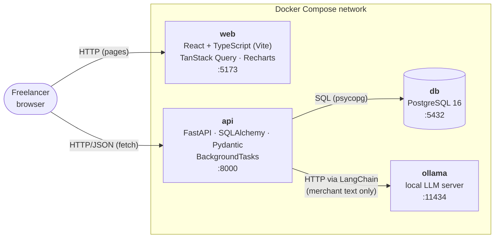
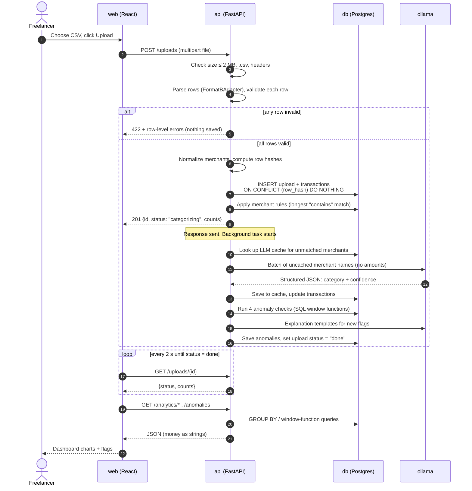
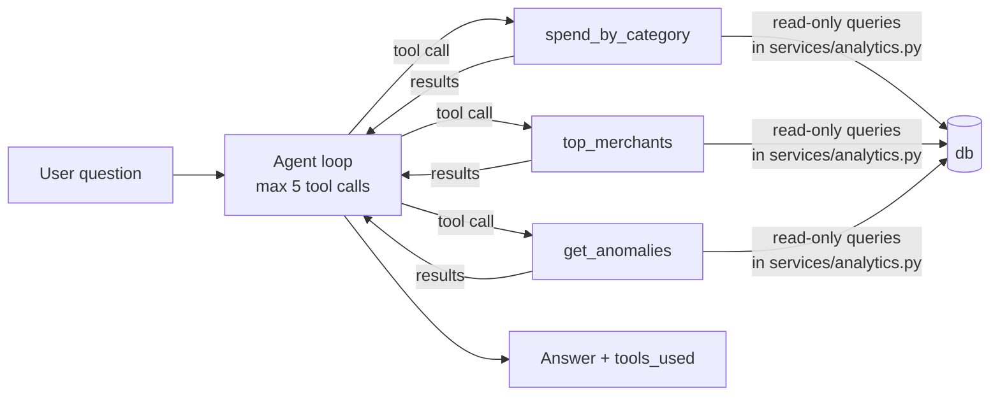

# 07 — Architecture

## 1. System overview

SpendSense runs entirely on one machine with **Docker Compose**: four containers, no
cloud services, $0 cost. Cloud deployment is deferred; see [ADR-002](adr/ADR-002-defer-cloud-deployment.md).



| Container | What it does | Why it's separate |
|---|---|---|
| `web` | Serves the React app (Vite dev server locally) | Frontend and backend deploy and scale independently |
| `api` | REST API: upload, categorize, detect anomalies, analytics, agent | Single place for business rules and DB access |
| `db` | Stores uploads, transactions, rules, LLM cache, anomalies | Postgres gives `NUMERIC` money, window functions, constraints |
| `ollama` | Runs the open-source LLM on CPU | Keeps data on the machine; free; swappable model |

**Data volumes:** `pgdata` (database files) and `ollama_models` (the downloaded model,
several GB, so it's downloaded only once).

**Config:** all settings come from environment variables (`.env`, gitignored). A
committed `.env.example` lists every variable with placeholder values:
`DATABASE_URL`, `OLLAMA_BASE_URL`, `OLLAMA_MODEL`, `LLM_BATCH_SIZE`, `MAX_UPLOAD_MB`,
`MAX_UPLOAD_ROWS`, `VITE_API_URL`.

## 2. Backend structure

```
backend/
├── app/
│   ├── main.py              # FastAPI app, CORS, routers, startup hook
│   ├── config.py            # Settings from env vars (pydantic-settings)
│   ├── db/
│   │   ├── session.py       # engine + session factory
│   │   └── models.py        # SQLAlchemy tables (08-data-model)
│   ├── api/                 # one router per resource (09-api-spec)
│   │   ├── health.py  uploads.py  transactions.py
│   │   ├── analytics.py  anomalies.py  agent.py
│   ├── schemas/             # Pydantic request/response models
│   ├── services/            # business logic, no HTTP here
│   │   ├── csv_formats.py   # FormatBAdapter (adapter pattern → more formats later)
│   │   ├── normalizer.py    # merchant normalization
│   │   ├── ingest.py        # validate → normalize → hash → insert
│   │   ├── categorizer.py   # rules → cache → LLM (10-categorization-design)
│   │   ├── anomalies.py     # 4 checks (11-anomaly-design)
│   │   ├── explainer.py     # flag explanations
│   │   └── analytics.py     # SQL aggregations
│   ├── llm/
│   │   ├── client.py        # ChatOllama factory, timeouts
│   │   └── prompts.py       # prompt templates
│   └── agent/
│       ├── tools.py         # 3 read-only tools
│       └── agent.py         # tool-calling loop (max 5 calls)
├── alembic/                 # DB migrations
├── scripts/
│   ├── generate_data.py     # synthetic statement + ground truth (US-02)
│   └── eval_accuracy.py     # accuracy eval (US-14)
├── tests/                   # pytest: unit + integration (real Postgres)
└── pyproject.toml
frontend/
├── src/
│   ├── api/                 # typed fetch functions + TanStack Query hooks
│   ├── pages/               # Upload, Dashboard, Transactions, Flags, Ask
│   ├── components/          # charts, tables, forms
│   └── main.tsx
└── package.json
data/generated/              # generator output (gitignored)
```

> Scripts live in `backend/scripts/` (not a root `scripts/` folder) so they share the
> backend's Python environment and their tests run in CI. Decided while starting US-02.

**Rule of thumb:** routers handle HTTP (parse input, return status codes), services hold
the logic, and the db layer holds the tables. That separation lets services be unit-tested
without a web server.

## 3. Upload-to-dashboard data flow

Upload uses a **background job** (decision D1, [ADR-007](adr/ADR-007-background-upload-processing.md)):
the fast steps run during the request, and the slow LLM work runs after the response is sent.



**Failure paths**
- **Ollama down or times out:** unmatched rows get `Other` + `needs_review = true`, and
  explanations use templates. The upload still ends as `done`, and `GET /health` shows `ollama: down` (NFR-10).
- **API restarts mid-job:** on startup, any upload still `categorizing` is re-queued.
  That's safe to repeat, because every step is idempotent (upserts, unique constraints).
- **Unexpected error in the background task:** the upload is set to `failed` with an
  error message, and the rows already saved stay saved.

## 4. Agent flow (US-13)



The agent never sees SQL and can't write anything. Each tool is a normal Python function
with a Pydantic input schema; the LLM can only choose a tool and fill in its arguments.

## 5. Cross-cutting concerns

| Concern | How it's handled |
|---|---|
| Money | `NUMERIC(12,2)` ↔ `Decimal`; serialized as strings in JSON; the frontend formats strings and never does money maths in floats |
| Privacy | `llm/prompts.py` is the only place prompts are built; it accepts merchant strings only. Explanations use placeholders filled in by code (11-anomaly-design §6) |
| Validation | Pydantic on every request body and on every LLM output |
| Errors | One JSON error shape for all endpoints (09-api-spec §1) |
| CORS | Only the `web` origin (`http://localhost:5173`) is allowed |
| Logging | Python `logging`, one line per request with a request ID; LLM call count + latency |
| Testing | Unit tests for services; integration tests against real Postgres in Docker; the LLM is replaced by a fake in tests and CI |

## 6. New dependencies (need Vish's approval)

These aren't in the original stack list but are needed to make it work:

| Package | Side | Why it's needed |
|---|---|---|
| `uvicorn` | backend | The server that runs FastAPI |
| `psycopg[binary]` | backend | The PostgreSQL driver SQLAlchemy talks through |
| `python-multipart` | backend | FastAPI needs it to accept file uploads |
| `pydantic-settings` | backend | Reads config from env vars into a typed object |
| `httpx` | backend (tests) | Powers FastAPI's `TestClient` for API tests |
| `pytest-cov` | backend (tests) | Coverage report (SM-7) |
| `langchain-ollama` | backend | ✅ already approved |
| `react-router-dom` | frontend | Page navigation (Upload / Dashboard / …) |
| `@testing-library/react`, `jsdom` | frontend (tests) | Render components in Vitest |
