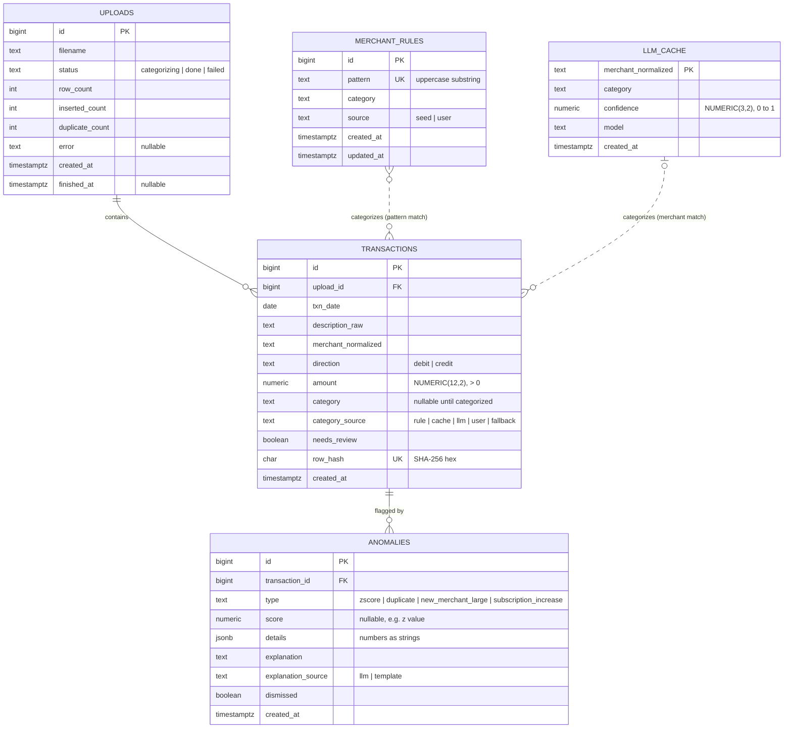

# 08 — Data Model

PostgreSQL 16, managed with **Alembic** migrations (every schema change is a versioned,
reviewable file).

## 1. ERD



> The original brief listed 4 tables. **`llm_cache` was added** because the cache
> needs somewhere to live, and it keeps "what the LLM said" separate from "what the user
> decided" (rules).

## 2. Tables in detail

### `uploads`
| Column | Type | Constraints | Notes |
|---|---|---|---|
| id | `BIGINT GENERATED ALWAYS AS IDENTITY` | PK | |
| filename | `TEXT` | NOT NULL | Original name, for display only |
| status | `TEXT` | NOT NULL, CHECK in (`categorizing`,`done`,`failed`) | Drives UI polling |
| row_count / inserted_count / duplicate_count | `INTEGER` | NOT NULL, ≥ 0 | Returned to the UI |
| error | `TEXT` | NULL | Set when `failed` |
| created_at / finished_at | `TIMESTAMPTZ` | created_at default `now()` | |

### `transactions`
| Column | Type | Constraints | Notes |
|---|---|---|---|
| id | `BIGINT IDENTITY` | PK | |
| upload_id | `BIGINT` | FK → uploads.id, ON DELETE CASCADE | Which file it came from |
| txn_date | `DATE` | NOT NULL | Bank exports have no times |
| description_raw | `TEXT` | NOT NULL | Exactly as in the CSV |
| merchant_normalized | `TEXT` | NOT NULL | Output of the normalizer (10 §3) |
| direction | `TEXT` | NOT NULL, CHECK in (`debit`,`credit`) | From which CSV column had a value |
| amount | `NUMERIC(12,2)` | NOT NULL, CHECK `amount > 0` | **Always positive**; `direction` gives the sign |
| category | `TEXT` | NULL, CHECK in the 13 categories | NULL only while waiting for the LLM |
| category_source | `TEXT` | NULL, CHECK in (`rule`,`cache`,`llm`,`user`,`fallback`) | For the eval and the UI |
| needs_review | `BOOLEAN` | NOT NULL default false | Low confidence or fallback |
| row_hash | `CHAR(64)` | NOT NULL, **UNIQUE** | De-dupe key (§3) |
| created_at | `TIMESTAMPTZ` | default `now()` | |

**Why `amount > 0` + `direction` instead of a signed amount?** It makes queries read
like English (`WHERE direction = 'debit'`), and a CHECK constraint makes "negative
debit" impossible. Format B already has separate Debit/Credit columns, so it maps directly.

**Why `TEXT` + `CHECK` instead of a Postgres `ENUM` for category?** Changing an ENUM
later (rename or remove a value) is painful in migrations; a CHECK constraint is just
dropped and re-created.

### `merchant_rules`
| Column | Type | Constraints | Notes |
|---|---|---|---|
| id | `BIGINT IDENTITY` | PK | |
| pattern | `TEXT` | NOT NULL, UNIQUE, CHECK `pattern = upper(pattern)` | Matched as a substring of `merchant_normalized` |
| category | `TEXT` | NOT NULL, CHECK in the 13 categories | |
| source | `TEXT` | NOT NULL, CHECK in (`seed`,`user`) | Seed rules ship with the app; user rules come from corrections |
| created_at / updated_at | `TIMESTAMPTZ` | | |

### `llm_cache`
| Column | Type | Constraints | Notes |
|---|---|---|---|
| merchant_normalized | `TEXT` | PK | One LLM answer per merchant, ever |
| category | `TEXT` | NOT NULL, CHECK in the 13 categories | |
| confidence | `NUMERIC(3,2)` | CHECK between 0 and 1 | |
| model | `TEXT` | NOT NULL | Which model answered (useful if we switch) |
| created_at | `TIMESTAMPTZ` | | |

### `anomalies`
| Column | Type | Constraints | Notes |
|---|---|---|---|
| id | `BIGINT IDENTITY` | PK | |
| transaction_id | `BIGINT` | FK → transactions.id, ON DELETE CASCADE | The flagged charge |
| type | `TEXT` | NOT NULL, CHECK in the 4 types | |
| score | `NUMERIC(8,3)` | NULL | z value, ratio, or % increase |
| details | `JSONB` | NOT NULL | e.g. `{"mean": "25.00", "std": "10.00", "window_n": 12}`. Money as strings |
| explanation | `TEXT` | NOT NULL | Final sentence shown to the user |
| explanation_source | `TEXT` | CHECK in (`llm`,`template`) | |
| dismissed | `BOOLEAN` | NOT NULL default false | Survives re-runs |
| created_at | `TIMESTAMPTZ` | | |
| | | **UNIQUE (transaction_id, type)** | Re-running the checks updates rows instead of duplicating them |

## 3. Row hash (de-duplication)

```
occurrence = how many identical (date, description, debit, credit) rows appeared
             earlier in the SAME file (0 for the first, 1 for the second, …)
row_hash   = sha256( f"{date}|{description_raw.strip()}|{debit}|{credit}|{occurrence}" )
```

- Upload the same file twice → same hashes → `ON CONFLICT (row_hash) DO NOTHING` skips them all.
- A real double charge in one file → occurrence 0 and 1 → different hashes → both saved.
- Overlapping exports (Jan–Feb, then Feb–Mar) → February rows hash the same in both
  files → only March is inserted.

## 4. Indexes

| Index | Columns | Used by |
|---|---|---|
| `uq_transactions_row_hash` | `row_hash` (unique) | De-dupe on insert |
| `ix_transactions_date` | `txn_date` | Monthly filters, trends |
| `ix_transactions_category_date` | `(category, txn_date)` | Spend by category, rolling z-score window |
| `ix_transactions_merchant_date` | `(merchant_normalized, txn_date)` | Duplicate check, new-merchant check, subscriptions, corrections |
| `ix_transactions_upload` | `upload_id` | Upload status counts |
| `uq_anomalies_txn_type` | `(transaction_id, type)` (unique) | Idempotent anomaly re-runs |
| `ix_anomalies_dismissed` | `(dismissed, created_at)` | Flags page |

`merchant_rules` and `llm_cache` are small (hundreds of rows) and are loaded into memory
per categorization run, so they only need their PK/unique indexes.

**Why not index everything?** Every index speeds up reads but slows down writes and
uses disk. Each index here is justified by a specific query.

## 5. Migrations & seed data
- `0001_initial`: all 5 tables, constraints, indexes.
- `0002_seed_rules`: ~40 seed `merchant_rules` for common synthetic merchants (Loblaws
  → Groceries, Netflix → Subscriptions, Uber Eats → Dining, …).
- Every migration has a working `downgrade()`, so it can be rolled back.
